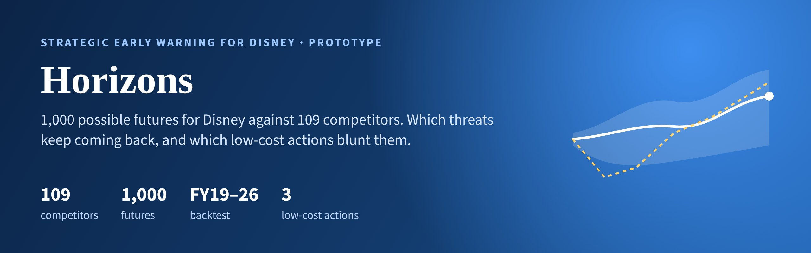
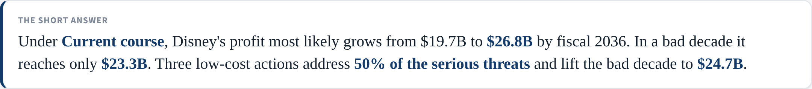
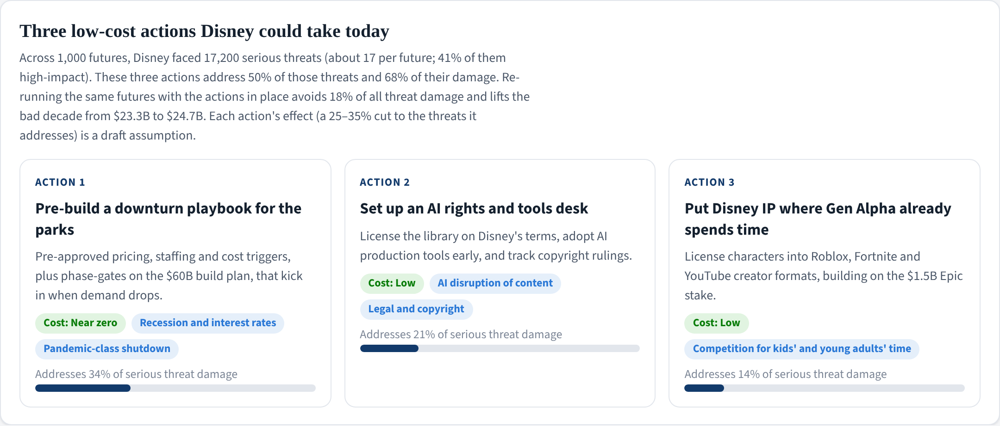
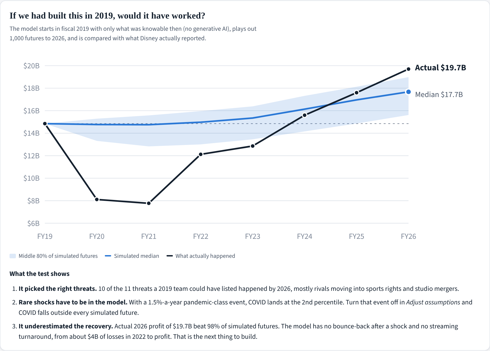
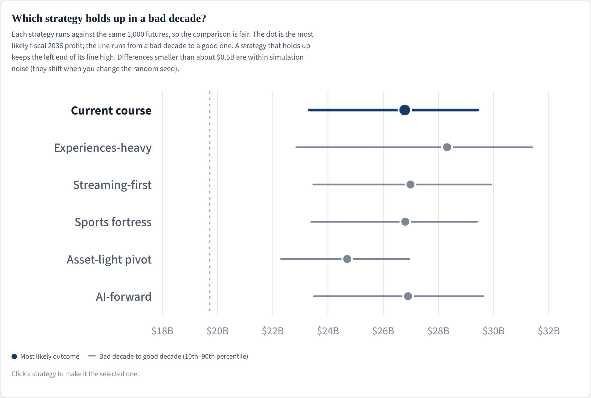

<p align="center"><a href="https://jrs10039-code.github.io/Horizons-strategy-games/"></a></p>

<p align="center"><a href="https://jrs10039-code.github.io/Horizons-strategy-games/"></a></p>

<p align="center"><b>Runs in your browser. No login, no install.</b><br><b>Horizons</b> is a prototype by Jake Schmidt · November 2026<br><sub>Named for the EPCOT attraction (1983–1999) that showed guests possible futures and let them choose their ending.</sub><br> · Illustrative draft assumptions, not a forecast</p>

---

### The short answer it gives



### Three low-cost actions, tested across 1,000 futures



### Would it have worked in 2019?

The model starts in FY19 with only what was knowable then, and is compared with what Disney actually reported.



### Which strategy holds up in a bad decade?



---

## What it answers

- **What happens when rivals think for themselves?** The AI War Room tab has 13 AI agents play out the decade in two-year turns: Disney, Netflix, Skydance (Paramount + Warner Bros.), Comcast/Universal, YouTube, Amazon, gaming platforms, the sports leagues, one player for the ~100 smaller rivals, and three newcomers that a casting AI picks fresh for each game (one real company, two invented ones built on emerging technology). An AI referee scores every move in dollars and an AI analyst reports what Disney should do. Each click plays 3 games; a scenario test plays 2 matched pairs (same shocks and newcomers, with and without the scenario), and you can add games to firm up a finding. It runs on the viewer's Claude account on the Claude-hosted copy, or through a private relay ([setup](docs/ai-war-room-setup.md)) on the public site.

- **What could knock Disney off course, and what can it do today?** For each of 1,000 futures the tool ranks that future's costliest threats. It then finds the threats that keep recurring and picks the three low-cost actions that cover the most serious-threat damage. Finally it re-runs every future with those actions in place to measure the effect. With default assumptions, three actions address about half of serious threats and lift the bad decade by about $1.4B. See [docs/examples.md](docs/examples.md).

- **Which playbook holds up?** Six Disney playbooks run against the *same* simulated futures, so the comparison is fair. Robust playbooks keep the bad case (10th percentile) high, not just the median.
- **What should we watch?** Each event is ranked by what it costs when it hits. The costliest ones become **signposts**: observable signals worth monitoring.
- **Would it have worked before?** Backtest mode starts in FY19 with only a 2019 view of the world and compares the simulated futures with what Disney actually reported through FY26. Results are in [docs/methodology.md](docs/methodology.md#5-backtest-fy19-to-fy26).
- **Does early warning pay?** With triggers on, Disney responds after the first hit of a threat type, and later hits land softer. The simulator measures how much that protects the bad case.

## How the model works

1. **Starting point:** FY26 segment operating income from Disney's FY26 Q4 8-K: Experiences $11.19B, Entertainment $5.44B, Sports $3.09B.
2. **Each simulated year**, events fire with set annual probabilities:
   - **PESTLE shocks**, meaning Political, Economic, Social, Technological, Legal and Environmental (recession, AI content flood, hurricanes, copyright rulings, and so on), weighted by category
   - **Competitor moves** by 109 companies (Netflix wins a sports package, Universal opens a nearby park, Qiddiya opens Gulf giga-parks, and so on). Each company has a tier that sets how much it can hurt: tier 1 can move a whole segment, tier 3 is early or narrow. Aggression can be set per arena or per company. Full list: [`docs/competitors.md`](docs/competitors.md)
   - **Startup archetypes** (AI-native studio, personalized AI media, and so on), which arrive once and stay
3. Each event cuts or lifts segment OI by a set fraction for a set number of years.
4. **The playbook** sets each segment's base growth and its exposure to each threat type.
5. Repeat 1,000–5,000 times, with a seeded random generator so results can be reproduced.

Every number lives in [`config/assumptions.json`](config/assumptions.json). Disagree with one? Change it and rerun.

## Repo layout

| Path | What it is |
| --- | --- |
| `index.html` | The browser simulator. One self-contained file with sliders for every assumption. |
| `engine/simulator.py` | Python reference engine: same model, no UI, reads the assumptions file. |
| `run.py` | Command-line runner: playbook comparison plus the costliest events. |
| `config/assumptions.json` | Every assumption: players, events, impacts, probabilities, playbooks. |
| `docs/competitors.md` | The 109-company roster by arena and tier, with each one's threatening move. |
| `docs/examples.md` | Example results: the three-action thesis, recurring threats, sample futures. |
| `docs/stress-test.md` | Pressure tests, the bug found and fixed, and suggestions. |
| `api/agent.js` | Private relay for the AI War Room: holds the API key, checks a passcode, picks the model per role. |
| `docs/ai-war-room-setup.md` | 15-minute setup to switch on live AI games for the public site. |
| `docs/methodology.md` | Mechanics, calibration, backtest results and known limits. |
| `tests/` | Checks for reproducibility, the starting point, trigger value, and pure compounding. |

```bash
python run.py                          # default assumptions, 1,000 futures per playbook
python run.py --runs 5000 --playbook D
python run.py --backtest               # FY19 start, compared with actuals
python -m pytest tests
```

No dependencies beyond Python 3.9+ (pytest for the tests).

## How a strategy team would productionize it

| Layer | Prototype | Production |
| --- | --- | --- |
| Engine | One Python file | Same logic, versioned and tested; assumptions owned by the strategy team |
| Data | Public filings, draft judgment | Capital IQ / FactSet for competitors; internal FP&A for Disney's own numbers |
| Interface | One HTML page | The team's existing BI tool or a small internal app |
| Access | Public link | Company cloud and single sign-on; insider inputs for managers and up only |
| Monitoring (phase 2) | Not built | An approved AI model reads news, earnings calls and M&A, then *proposes* input changes. A manager approves each one, every change is logged, and the sim reruns on triggers (earnings, major deals). |

**Model-agnostic by design.** The engine contains no AI. AI only sits in the phase 2 monitoring layer, behind a thin adapter, so the model is a configuration choice.

**Pilot proposal.** 6–12 months. Before it starts, the team logs its own risk calls with timestamps. Keep the tool only if it flagged 3–5 risks earlier than the team did.

## Roadmap

- [x] **2019 backtest:** 10 of 11 listed threats happened; the COVID trough lands at the 2nd–4th percentile with a tail event; the recovery outran the model.
- [x] Risk-and-actions analysis with re-simulation (browser)
- [ ] Port the risk-and-actions analysis to the Python engine
- [ ] Correlated shocks, and competitors that react to Disney
- [ ] Real financial data via SEC EDGAR and Capital IQ/FactSet (needs a small backend)
- [ ] Streaming margin as its own variable, plus rebound dynamics after shocks (the main backtest miss)
- [ ] Disney M&A moves and a balance sheet (cash and debt limits on moves)
- [ ] Phase 2 monitoring pilot
